# CleanYourTV Phone Remote for Android

[](https://github.com/Edenik/CleanYourTV-Phone-Remote-Android/actions/workflows/ci.yml)

An Android app for the **Phone remote** of [CleanYourTV for LG webOS](https://github.com/lasharor/cleanyourtv-WebOS). Nearly all of it
is not an app: the remote, the pairing, the keys and the Power sheet are the TV's own page (`http://<tv>:8799/`), loaded in a WebView.
The app adds the two things a browser cannot do:

- **Turn the TV on.** It sends the Wake-on-LAN packet, so the Power button works with the TV off, with no extra device on the network.
- **Open while the TV is off.** The TV's page cannot load then, so the app shows the last copy it kept (the remote with its On button).

One activity, Java only, no libraries, no AndroidX, no Gradle. About 30 KB. No account, no analytics: the app talks only to your TV.

## Install

Scan this code with the phone's camera (or [open the link](https://github.com/Edenik/CleanYourTV-Phone-Remote-Android/releases/latest/download/tv-remote.apk)),
open the download and install it. Android asks once to allow the browser to install apps.

<p align="center"></p>

The package is signed with a local debug key: fine for sideloading, not for the Play Store. Google Play Protect says
"This app looks safe".

<p align="center">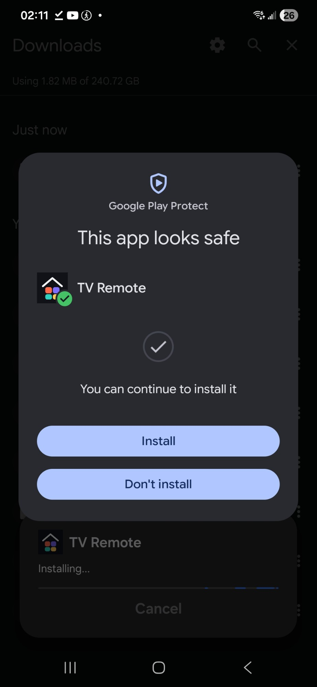</p>

## Set up

1. On the TV, in the manager app, switch on **Features › Phone remote** and open the pairing screen. It shows the TV's address
   (for example `http://192.168.1.50:8799`) and a six-digit code.
2. Open the app and tap **Find my TV**. The address it finds is only filled into the field: tap **Continue** to open it. Or tap
   **Type the address instead**.
   (The app also opens a `cytv://add?host=<address>&code=<code>` link, but the TV's manager does not show one: the TV's QR code is a
   plain web address that opens the page in the browser.)
3. The TV's page asks for the code. Enter it, name the phone and tap **Pair**. Done: next time, open the app and the remote is there.

The address must be written as numbers: a private or link-local IPv4 address (`10.x.x.x`, `172.16.x.x` to `172.31.x.x`,
`192.168.x.x`, `169.254.x.x`), with a port if it is not 8799. Names such as `lgwebostv.local`, public addresses and IPv6 are refused.

The TV needs **TV On With Mobile** (Wake-on-LAN) switched on to be woken, and the phone must be on the same Wi-Fi. The TV's page hands
the TV's MAC address to the app when it connects, so the app needs no setup for waking.

## Screenshots

The screens before the remote, drawn at 412 × 915 in Chrome with the app's bridge stubbed. They are the real pages of the app
(`web/start.html`, `web/off.html`) and the TV's pairing page, but they were **not captured on a physical phone**. Find my TV now ends
with the address filled in and a toast ("Found the TV at … Tap Continue to open it.") instead of opening the TV.

| Find your TV | Type the address | Bad address | Looking | Not found |
|:--:|:--:|:--:|:--:|:--:|
| 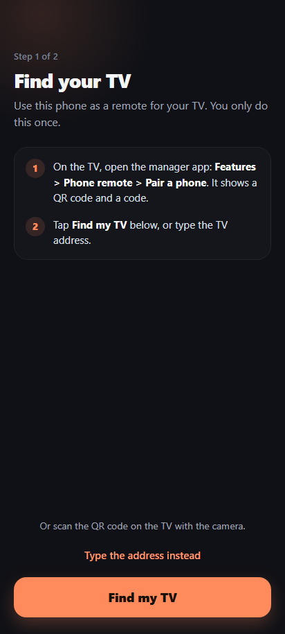 | 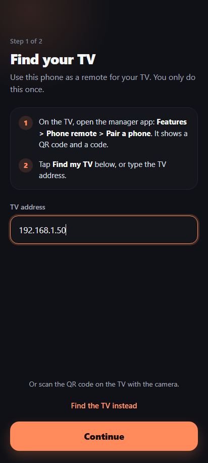 | 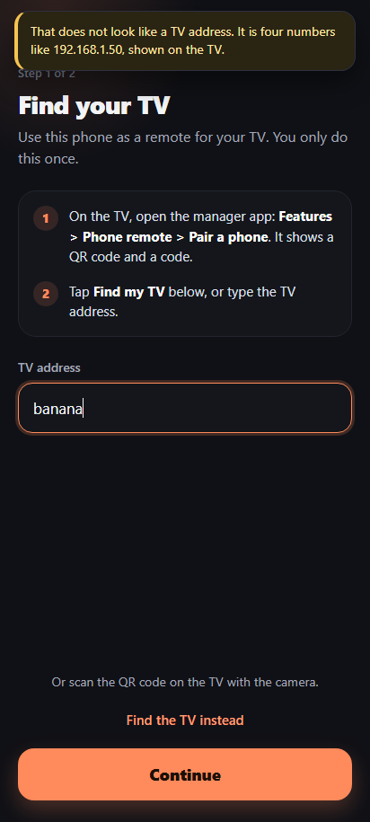 | 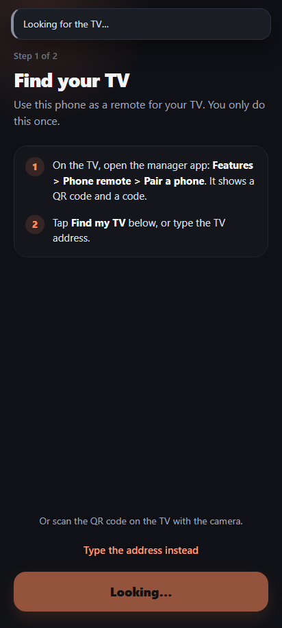 | 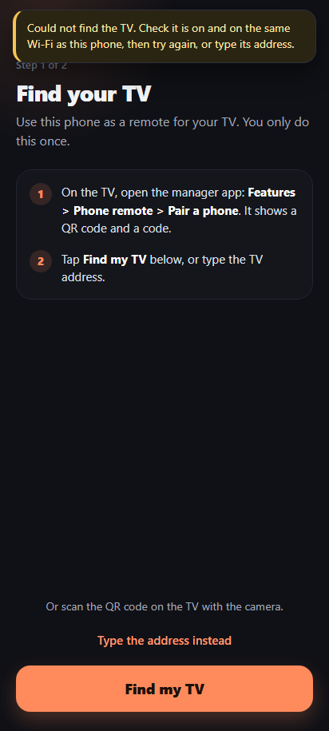 |

| Can't reach your TV | The TV is off | Wake failed | Enter the code (step 2 of 2) | Wrong code |
|:--:|:--:|:--:|:--:|:--:|
| 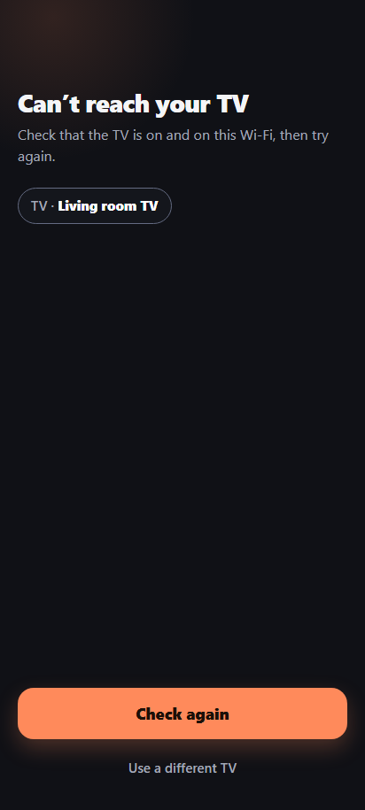 | 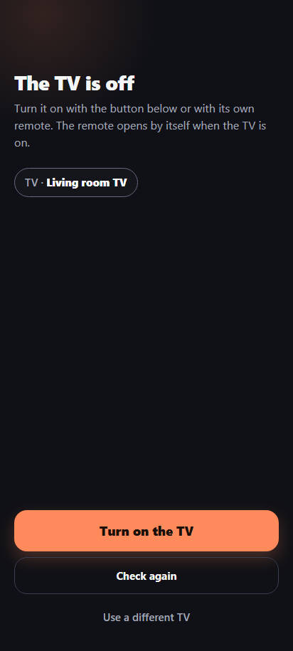 | 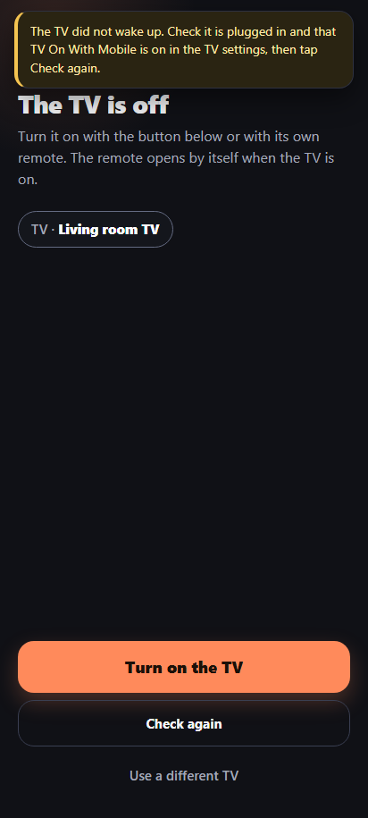 | 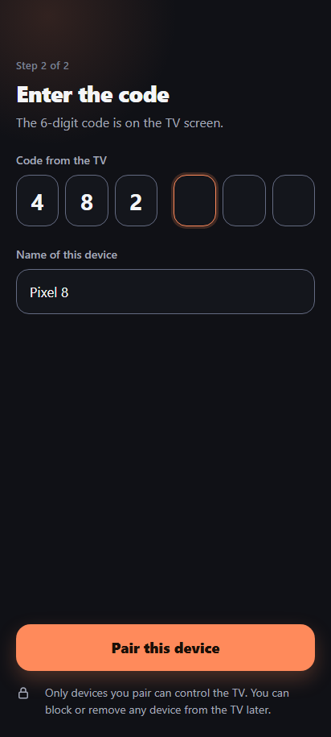 | 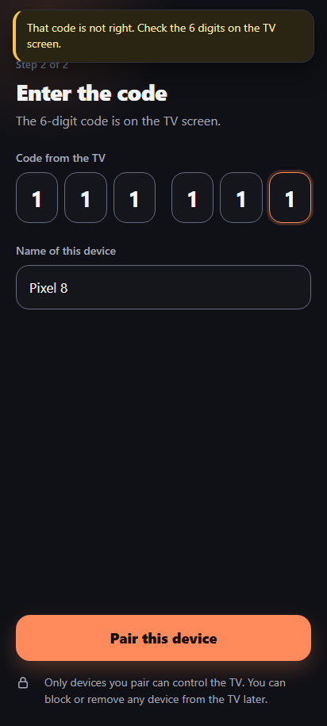 |

The remote itself is the TV's page, the same in the app and in a browser:

| Remote | Touchpad | Apps | Live |
|:--:|:--:|:--:|:--:|
| 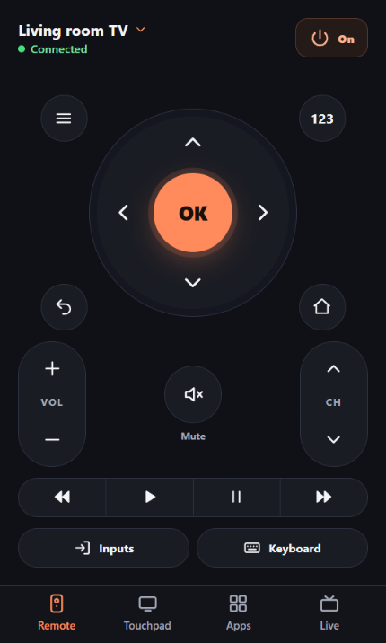 | 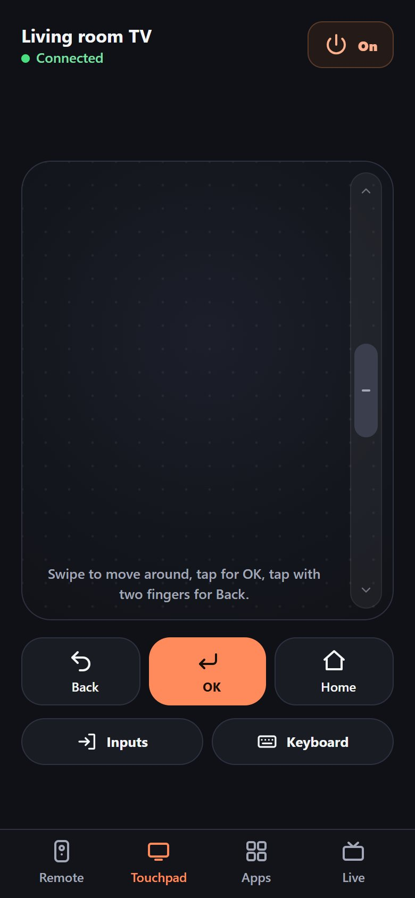 | 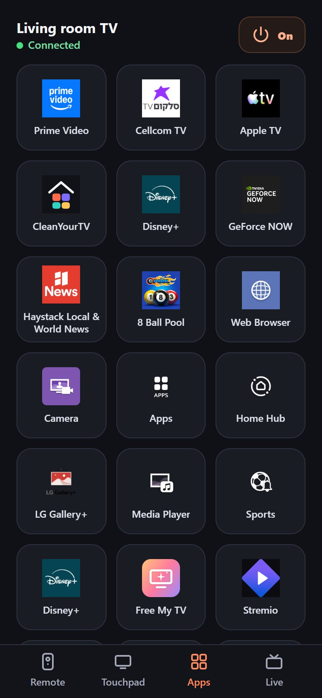 | 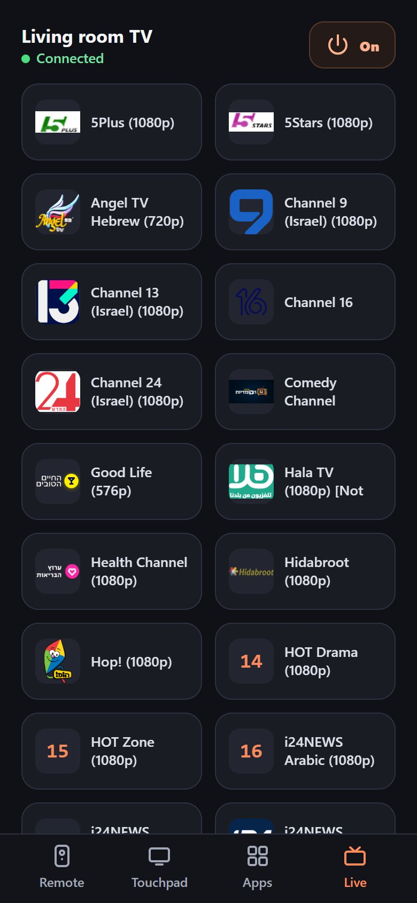 |

## What it keeps on the phone

| What | Where | Why |
|---|---|---|
| the TV's address (`192.168.1.50:8799`) | app settings (SharedPreferences) | to open the page and to check the TV came back |
| the TV's MAC address | app settings | for the Wake-on-LAN packet |
| the last copy of the TV's page | the app's files | to show the remote while the TV is off |
| the phone remote's token | the WebView's `localStorage`, under the TV's own address | pairing lives in the page, not in the app |

The phone's name (the Android setting, else maker and model) is read only to fill the pairing form and is not stored by the app.
**Log out of this TV** in the page deletes all of the above.

Two permissions, no more: `INTERNET`, and `VIBRATE` (a key press answers with a short tick; a WebView cannot vibrate from the page).

## Build

Needs Java 8 or newer (`javac`, `keytool`), Python 3 and the Android SDK (`ANDROID_HOME`, or the usual place on Windows) with
build-tools `34.0.0` and platform `android-34`. It uses the SDK's own `aapt2`, `javac`, `d8`, `zipalign` and `apksigner`; nothing is
downloaded.

```sh
powershell -ExecutionPolicy Bypass -File android/build.ps1
```

The result is `dist/tv-remote.apk`, and the build prints its SHA-256. `-Sdk <path>`, `-JavaHome <path>`, `-BuildTools` and `-Platform`
change where it looks. A package is not byte for byte the same on every machine (zip times, the local signing key), so each release
states the SHA-256 of the file it carries.

## Tests

```sh
npm test
```

- `test/mobile.test.js`: the start pages against the bridge, the address rules, the wake packet and the back-off (`Addr.java` and
  `Backoff.java` are compiled and run when a JDK is installed; `REQUIRE_JAVAC=1` makes a missing JDK a failure).
- `test/docs.test.js`: every link and image in the Markdown files exists, every screenshot is used, the install QR code and the release
  link agree, no package or key is committed, and no real IP or MAC address is in the repository.

Neither builds or runs the app: that needs the Android SDK and a phone. Checks that read the TV's own page run only when `CYTV_REPO`
points at a checkout of [cleanyourtv-WebOS](https://github.com/lasharor/cleanyourtv-WebOS).

**CI** (`.github/workflows/ci.yml`) runs on every push to `main` and `dev` and every pull request:

| Job | What it checks |
|---|---|
| Tests (Node 16, 20, 22) | `npm test` with a JDK and `REQUIRE_JAVAC=1` |
| Manifest, resources and pages | the manifest and resource XML parse, the bundled pages' scripts parse, every Java file compiles against `android.jar` (API 34) |
| Build the APK (Windows) | `android/build.ps1` builds and verifies the package; the package name, app name, target SDK 34 and the two permissions (`INTERNET`, `VIBRATE`, nothing else) are checked; the APK and its SHA-256 are attached to the run |

## Limits

- Android only. The start pages and the bridge are plain web code, so an iOS shell would reuse them, but it would need its own Xcode project.
- The app keeps one TV; keeping several is not part of it.
- Find my TV uses a reply only when it says `webos-second-screen` in `ST:` or `USN:`, so another machine on the network cannot answer
  the search and get the page (and the bridge) for itself.
- Plain HTTP to the LAN is on purpose (`usesCleartextTraffic`): that is how the TV serves its page.
- Switching the TV between cable and Wi-Fi changes its MAC: open the app once with the TV on and it learns the new one.
- Not run on a physical phone since the Find my TV change (the Java compiles and the tests pass); the Wake-on-LAN packet was tried from a computer.

## More

- [docs/bridge.md](docs/bridge.md): what the page can ask of the app, and the rules that keep the bridge safe.
- [AGENTS.md](AGENTS.md): a briefing for AI assistants working on this repository.
- The TV side and the protocol: [cleanyourtv-WebOS](https://github.com/lasharor/cleanyourtv-WebOS).

MIT licence, see [LICENSE](LICENSE).
